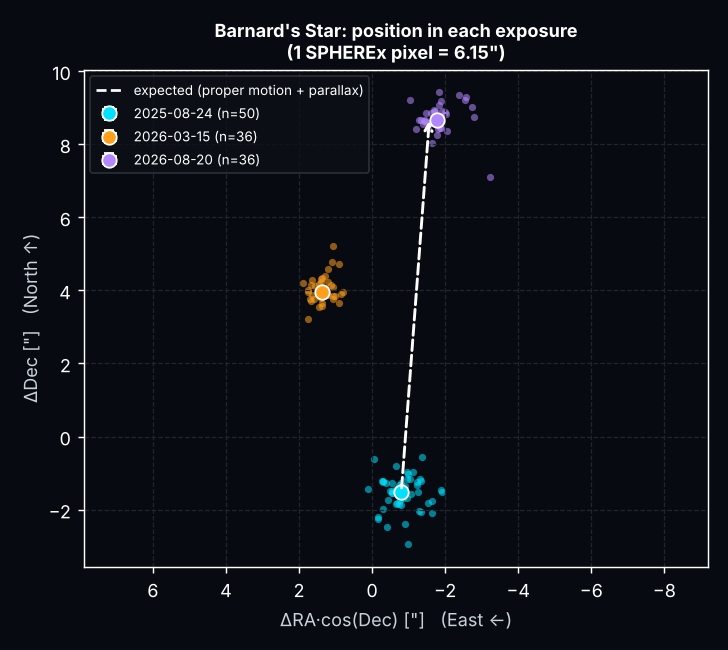
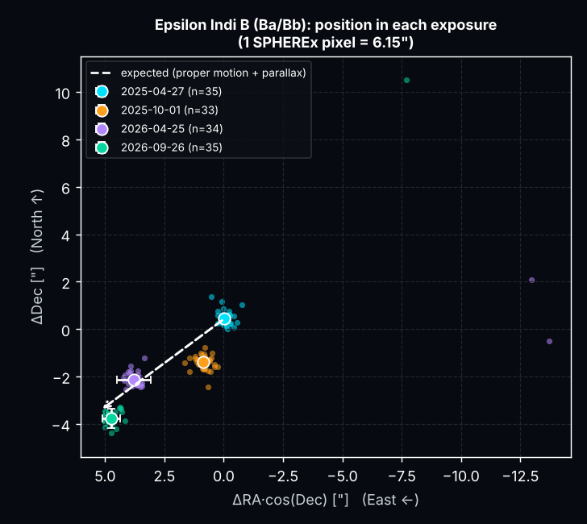

# SPHEREx Blink

A blink comparator for NASA's SPHEREx all-sky infrared survey: type a coordinate, see what moved.

**Team Dirac Sons** · Yahashua Paredes and Ezequiel Guerrero · Quito, Ecuador
**NASA Space Apps Challenge 2026** · Challenge: *Planet X and SPHEREx*

Pluto was discovered by comparing two photographs of the same patch of sky. SPHEREx photographs the whole sky every six months in 102 near-infrared bands. This tool takes a sky position, finds every SPHEREx exposure that covers it, and plays the visits back as a short animation so that anything that moved or changed stands out.

## What it does

- Enter a name or RA/Dec and get one image per SPHEREx visit, played as a blink animation.
- Difference image (last visit minus first) and sum image.
- Compare visits within a single detector band, so brightness changes are not an artefact of mixing wavelengths.
- Adjustable field of view.
- Coordinates in the URL (`?ra=…&dec=…&fov=…`), so a view can be linked or embedded.
- Measures the position of the central source in every exposure and reports the shift between visits with error bars.
- Flags saturated stars and hides their spectrum, because aperture photometry is not reliable there.

## Results on real SPHEREx data

All five test targets named in the challenge were run end to end on real data.

| Target | Exposures | Outcome |
|---|---|---|
| Barnard's Star | 108 | Motion measured, agrees with catalog |
| Epsilon Indi B | 144 (4 visits) | Motion measured, agrees with catalog |
| RW Aurigae | 108 | Saturated; no motion, as expected (0.23″ ± 0.5) |
| R Draconis | 72 | Saturated; shows a spurious 1.4″ shift (see Limitations) |
| WISE 0855 | 102 | Not detected: too faint in single exposures |

**Barnard's Star, Aug 2025 → Aug 2026** (same detector orientation):

| | East–west | North–south |
|---|---|---|
| Measured | −0.98″ ± 0.10 | +10.17″ ± 0.10 |
| Catalog (proper motion + parallax) | −0.77″ | +10.25″ |



The figure and table use 122 exposures. The copy served by the web app was computed from 108 exposures and gives −1.01″ ± 0.11 and +10.16″ ± 0.11.

**Epsilon Indi B, Apr 2025 → Sep 2026** (a brown dwarf pair, not saturated):

| | East–west | North–south |
|---|---|---|
| Measured | +4.77″ ± 0.36 | −4.19″ ± 0.41 |
| Catalog | +5.24″ | −3.87″ |



One SPHEREx pixel is 6.15″. The scatter of single-exposure positions for Barnard's Star is about 0.5″.

## How it works

The archive's search services (IRSA TAP and SIA) returned errors for the whole hackathon weekend, so the tool does not depend on them.

1. **Sky index** (`backend/sky_index.py`). Reads the pointing of every exposure in the public SPHEREx bucket on AWS, once: 151 half-weeks, about 270,000 exposures. A coordinate is then matched against the whole table with one vectorised comparison.
2. **Cutouts** (`backend/s3_cutout.py`). Fetches only the image rows it needs with HTTP byte-range requests, instead of downloading each 71 MB file.
3. **Download queue** (`backend/download.py`). A priority queue interleaves visits and detectors, so every visit gets its first frames early. Results are cached on disk.
4. **Visit stacks** (`science/science.py`). Exposures are reprojected to a common grid using the full distortion model, then combined per visit and per detector, weighted by inverse variance.
5. **Positions** (`science/astrometry.py`). A profile is fitted to the source in each exposure, excluding saturated pixels. Each visit reports the median position and its statistical error.
6. **Orchestrator** (`backend/pipeline.py`). Runs all steps for a list of targets and stores the result in `precomputed/`, which the web app serves instantly.

## Run it locally

```bash
pip install -r requirements.txt
cd backend
python -m uvicorn api:app --reload
```

Open http://localhost:8000. The five test targets load instantly from `precomputed/`.

To process a new target or coordinate with real data:

```bash
python pipeline.py "Barnard's Star"     # by name (the five test targets are built in)
python pipeline.py 150.1 2.2            # by RA and Dec in degrees
python pipeline.py --status             # what is indexed, downloaded and computed
```

The sky index is included in the repository (`backend/index/sky/`). To extend it after a new data release, run `python sky_index.py`.

Data source modes, set with the `SPHEREX_SOURCE` environment variable:

| Value | Behaviour |
|---|---|
| `fake` (default) | Any position not in `precomputed/` shows **synthetic** data, clearly labelled |
| `irsa` | Real data: own index plus cutouts from the public cloud copy |
| `demo` | Public demo: only serves what is in `precomputed/` |

A `Dockerfile` is included; it starts the app in `demo` mode.

## Repository layout

```
backend/      data access, sky index, cutouts, API, orchestrator
science/      image stacking, astrometry, synthetic-data test suite
web/          the single-page front end
precomputed/  results for the five test targets (real data)
docs/         figures, and the original work plan (in Spanish)
```

## Limitations

- **Saturated stars.** Barnard's Star, RW Aurigae and R Draconis saturate the detector. Positions are measured from the wings of the star. Between visits six months apart the detector is rotated by 180°, and saturated stars then show a bias of about 1.5″ that is not included in the error bars. It cancels between visits one year apart.
- **Error bars are statistical only.**
- **Faint sources.** WISE 0855 is not detected in single exposures. Measuring it would need stacking before fitting.
- **No brightness curves.** The two variable stars saturate, so no light curve or spectrum is shown for them.
- **Spectra are not validated.** The spectrum shown for unsaturated sources has not been compared against a reference spectrum.
- **Continuously visible targets.** Near the ecliptic poles there are no gaps between visits, so the visit grouping uses only a small part of the available exposures (72 of 2,465 for R Draconis).
- **Catalog values** (positions, proper motions, parallaxes) were entered by hand and should be re-checked against Gaia DR3.
- **Flag bits.** The set of flag bits treated as bad pixels was chosen by inspecting real images and should be checked against the SPHEREx Explanatory Supplement.
- **Not implemented:** Gaia/WISE catalog overlay, display of contamination flags in the web page.
- `science/validate_and_test.py` tests the algorithms on **synthetic** images generated from the same catalog. It is a software test, not a validation against real data.

## Data and credits

- **SPHEREx** spectral images (Quick Release 2 and 3), NASA/JPL-Caltech, served by the NASA/IPAC Infrared Science Archive (IRSA) and its public copy on AWS Open Data.
- Inspired by **WiseView** and the **Backyard Worlds** citizen-science project.
- Built with Astropy, SciPy, reproject, FastAPI and Matplotlib.

## Use of AI

Claude (Anthropic) was used throughout the project. 